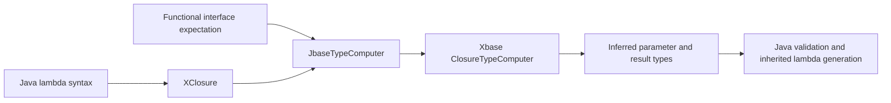

# Implementing Java lambda expressions with Xbase

Jbase parses Java lambda syntax into Xbase's existing `XClosure` model. It
reuses Xbase's functional interface inference, linking, parameter scopes, and
lambda compiler, and adds the checks needed by Jbase's Java statement syntax.
Method references also participate in closure inference, but use a dedicated
subtype and computation strategy; see [Method references](METHOD_REFERENCES.md).

## Where the implementation lives

| Source | Responsibility |
| --- | --- |
| [Jbase.xtext](../jbase/src/jbase/Jbase.xtext) | Java lambda headers, parameters, bodies, and casts. |
| [JbaseTypeComputer](../jbase/src/jbase/typesystem/JbaseTypeComputer.java) | Target expectations, raw functional interfaces, and delegation to Xbase's closure computation. |
| [JbaseReentrantTypeResolver](../jbase/src/jbase/typesystem/JbaseReentrantTypeResolver.java) | Defers writable-local capture checks until all uses have been linked. |
| [JbaseValidator](../jbase/src/jbase/validation/JbaseValidator.java) | Java target, parameter, body, capture, and branching rules. |
| [JbaseInitializedVariableFinder](../jbase/src/jbase/validation/JbaseInitializedVariableFinder.java) | Definite-assignment checks at closure creation. |
| [JbaseXbaseCompiler](../jbase/src/jbase/compiler/JbaseXbaseCompiler.java) | Preserves blank local declarations and Java loop behavior around inherited lambda generation. |
| [JbaseProposalProvider](../jbase.ui/src/jbase/ui/contentassist/JbaseProposalProvider.java) | Makes Jbase's expression scopes available to Eclipse completion. |
| [JbaseRuntimeModule](../jbase/src/jbase/JbaseRuntimeModule.java) | Binds the custom type computer, resolver, and compiler. |

## Grammar and model

`XAssignment` tries `XClosure` before ordinary assignment expressions. The
overridden `XClosure` rule recognizes these Java parameter forms:

```java
n -> n + 1
(x, y) -> x + y
(int x, int y) -> x + y
(var x, final var y) -> x + y
() -> System.out.println("hello")
```

The syntactic predicate recognizes the header through `->` before committing.
This distinguishes lambda parameters from parenthesized expressions and casts.
The arrow sets `explicitSyntax` even for `() -> ...`. In Xbase that flag means
the parameter list is explicit, not that every parameter has a written type;
Jbase therefore never asks Xbase to invent an implicit `it` parameter.

Parameter representation preserves the distinction between syntax and typing:

| Syntax | Model | Type information |
| --- | --- | --- |
| `n`, `(x, y)` | `JvmFormalParameter` | `parameterType` remains unset. |
| `(var n)`, `(final var n)` | `XJJvmFormalParameter` | Type remains unset; the model retains `final`. |
| `(int n)`, `(final String s)` | `XJJvmFormalParameter` | Contains the declared type and optional `final`. |
| `(String... values)` | `XJJvmFormalParameter` | The parameter type is an array reference. |

Leaving `var` untyped is intentional: it is a request to infer the parameter from
the functional interface, not a type named `var`. The grammar separates inferred
parameter lists from explicitly declared lists. The validator additionally
rejects mixing `var` and explicit types, such as `(var x, int y) -> x + y`.

`XJLambdaBody` accepts an expression or `XJLambdaBlock`. A block is an ordinary
`XBlockExpression` containing Jbase statements and their semicolon wrappers.
The predicate on the opening `{` keeps an incomplete block classified as a
block during editing, rather than allowing recovery as an array initializer.

## Target typing and linking



`JbaseTypeComputer._computeTypes(XClosure, ...)` creates a
`ClosureTypeComputer` for each type expectation. Xbase finds the functional
operation, substitutes the interface's type arguments, assigns parameter types,
and computes the body against the operation's return type. The expectations
must remain part of Xbase's computation: a lambda used as a method argument may
need both overload resolution and generic method inference before its type is
known. It should not be assigned a standalone type during parsing.

For example, the `String` parameter type in this expression comes from the
stream's element type and `map`'s functional interface parameter:

```java
java.util.stream.Stream.of("a", "bb").map(s -> s.length());
```

`JbaseExpressionArgumentFactory` retains the superclass's closure argument
handling. Its custom code concerns array assignments; it does not replace
Xbase's deferred lambda argument computation or argument reordering.

Two cases need explicit treatment in `JbaseTypeComputer`:

* **Cast targets.** `_computeTypes(XCastedExpression, ...)` supplies the cast type
  as an expectation for an `XClosure` target. Thus `(IntUnaryOperator) n -> n`
  provides the parameter type before computing the lambda. This also applies to
  the `XJMethodReference` subtype. The null-type guard preserves recovery for an
  incomplete cast in the editor.
* **Raw functional interfaces.** A raw interface is represented for computation
  with its type parameters replaced by their erased bounds. For raw `Consumer`,
  the lambda parameter is consequently `Object`, rather than an unconstrained
  Xbase type variable. Ordinary parameterized and wildcard targets stay on the
  normal closure computation path.

A lambda requires a functional interface target. `var f = n -> n` cannot
supply one; `var f = (IntUnaryOperator) n -> n` can, through its cast.

## Java-specific validation

`JbaseValidator.checkJavaLambda` augments the inherited Xbase checks:

* The target must be an interface with a functional operation. An operation
  that itself declares type parameters cannot be implemented by a Java lambda.
  This restriction is separate from generic *interface* parameters, as in
  `Function<String, Integer>`, which are supported.
* Explicit parameter types must match the functional descriptor. The direct
  identifier comparison is skipped for wildcard targets, whose parameter types
  need Xbase's ground-target inference instead of a literal wildcard comparison.
* A value-returning block must not fall through. Jbase statements use explicit
  `return`; `{ n + 1; }` is not a replacement for `{ return n + 1; }`.
* An expression body for a void target must be a Java statement expression.
  `() -> list.add("x")` may discard the method's result, whereas `() -> 1 + 2`
  is invalid for `Runnable`.

`checkClosureParams` deliberately removes Xbase's six-parameter restriction.
A Java functional interface may have more parameters. The override does not
remove the requirement to match the chosen interface's parameter list.

`checkBranchingStatementInternal` stops at an `XClosure` boundary: a `break` or
`continue` inside a lambda cannot target a loop outside that lambda. The normal
Xbase closure context also keeps a lambda's `return` local to the lambda.

## Effectively final captures and definite assignment

Xbase's early writable-local capture diagnostic is suppressed by
`JbaseReentrantTypeResolver.getInvalidWritableVariableAccessMessage`. Returning
`null` there transfers the decision to Jbase's validator; it does not make
mutable captures legal or remove checks on writes to explicit `final` variables.

After linking, `checkCapturedLocal` examines uses of external local variables
and formal parameters. `XbaseUsageCrossReferencer` supplies the complete set of
writes. `isLocalWrite` distinguishes reassignment, increment/decrement, and
compound assignment from an array element update, which does not reassign the
array variable.

An initialized local or method parameter must have no subsequent writes. A blank
local can instead have its first assignment before capture:

```java
int offset;
offset = 2;
java.util.function.IntSupplier supplier = () -> offset;
```

`isEffectivelyFinal` also permits assignments in mutually exclusive `if`/`else`
branches. It rejects repeated writes and assignments that can repeat inside a
loop or closure. `canRepeatWrite` distinguishes a basic `for` initializer, which
runs once, from the loop's repeated parts. `areExclusiveWrites` recognizes
opposite branches of the same conditional.

This analysis complements definite assignment. `JbaseInitializedVariableFinder`
checks a lambda body with a copy of the current initialized-variable set. Reads
inside the body must be valid at closure creation; writes in a body that has not
executed cannot initialize variables in the surrounding method.

Method reference receivers require different treatment. A bound reference reads
its receiver immediately, and the receiver variable may subsequently change.
`checkCapturedLocal` skips `XJMethodReference` ancestors when looking for the
enclosing lambda. It still finds an actual outer lambda in
`() -> text::trim`, where accessing the external `text` does involve capture.

## Generation and content assist

Jbase retains Xbase's lambda compiler. The generated Java can contain explicitly
typed lambda parameters and temporary functional interface variables even when
the source used inferred parameters or `var`:

```java
// Jbase input
java.util.function.IntUnaryOperator identity = (var n) -> n;

// Representative generated Java
final java.util.function.IntUnaryOperator _function = (int n) -> {
    return n;
};
java.util.function.IntUnaryOperator identity = _function;
```

`JbaseXbaseCompiler._toJavaStatement(XVariableDeclaration, ...)` preserves an
uninitialized declaration when it is used below a closure node. In the blank
`offset` example, generating `int offset = 0;` would turn `offset = 2;` into a
reassignment and make the emitted Java capture invalid.

`compileContinueStatement` also guards against updating a transformed outer
basic `for` loop when a `continue` belongs to a loop inside a lambda.

Completion inside a lambda uses the inferred parameter types and expression
scopes already maintained by Xbase. For example, `s -> s.len` can propose
`length` when the target parameter is `String`. Jbase's semicolon wrappers must
participate in scope tracking: `computeJbaseTypes(XJSemicolonStatement, ...)`
calls `withinScope` before computing the wrapped expression.

## Regression tests and maintenance

[JbaseLambdaTest](../jbase.tests/src/jbase/tests/JbaseLambdaTest.java) covers
inference, casts and other target contexts, `var`, raw/wildcard targets, explicit
types, captures, definite assignment, control-flow boundaries, generated Java,
and execution. The capture and generation cases are particularly useful when
changing a resolver or compiler binding.

[JbaseInitializedVariableFinderTest](../jbase.tests/src/jbase/tests/JbaseInitializedVariableFinderTest.java),
[JbaseContentAssistTest](../jbase.ui.tests/src/jbase/ui/tests/JbaseContentAssistTest.java),
[JbaseSerializerTest](../jbase.tests/src/jbase/tests/JbaseSerializerTest.java), and
[AllJavaFeaturesTest](../jbase.tests/src/jbase/tests/AllJavaFeaturesTest.java)
cover the supporting analysis and editor integration.

Follow the repository's `AGENTS.md` build instructions. From the repository root,
the existing runtime/UI suites and aggregate coverage can be checked with:

```sh
./mvnw -B -f jbase.releng/pom.xml verify -pl :jbase.tests.report -am -Pjacoco \
  -DskipMWE2 -DskipXtend \
  -Dtycho.localArtifacts=ignore -Djgit.dirtyWorkingTree=ignore
```

The skip flags assume generated sources are current. After grammar or Ecore
changes, regenerate without those flags. Sandboxed agents need expanded access
before running Maven because Tycho locks artifacts under `~/.m2`.
